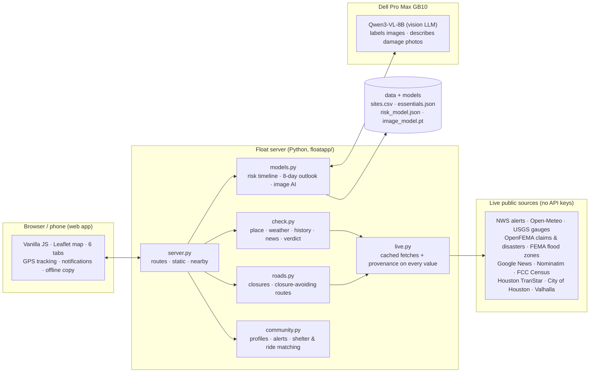

<p align="center"></p>

<h1 align="center">Float</h1>

<p align="center"><b>Flood safety for Greater Houston: know what's coming, where to go, and who can help.</b></p>

<p align="center"><b>Built By Ranya Bhartiya and Maneeshkumar Lillyprabhu.</b></p>

<p align="center">
<a href="https://float-inky-alpha.vercel.app">Live app</a> ·
Built on the <b>Dell Pro Max with NVIDIA GB10</b> ·
UTSA Social Impact AI Datathon
</p>

---

## Contents

1. [About Float](#about-float)
2. [The 14 features](#the-14-features)
3. [How Float was built on the Dell Pro Max GB10](#how-float-was-built-on-the-dell-pro-max-gb10)
4. [Why it matters: the impact, backed by IBISWorld](#why-it-matters-the-impact-backed-by-ibisworld)
5. [Architecture](#architecture)
6. [The AI models behind each feature, with metrics](#the-ai-models-behind-each-feature-with-metrics)
7. [Run, deploy and rebuild](#run-deploy-and-rebuild)
8. [Projected impact and estimated valuation](#projected-impact-and-estimated-valuation)

---

## About Float

Float is a mobile-first web app that answers one question for anyone in Greater Houston:

> **"Will a flood reach me this week, and what should I do?"**

It checks the user's exact location against live weather, official warnings, decades of federal
flood-insurance and disaster records, and local news. It combines these with an AI flood-risk model and
an aerial flood-image model trained on **1,204 labeled Texas flood images**, and turns everything into one
plain verdict: **No flooding expected**, **Flooding possible** or **Heavy flooding likely**.

Then it connects people to what they need: the nearest hospitals, pharmacies, grocery stores, fuel and
shelters; neighbors who can host them or drive them out; live road closures; and driving routes that go
around closed and flooded roads.

Every number in Float shows where it came from, so an official warning is never confused with an AI
prediction:

| Badge | Meaning | Example |
|---|---|---|
| **OFFICIAL** | Government warning | NWS Flash Flood Warning |
| **VERIFIED LIVE** | Live agency measurement | USGS river gauge, read 7 min ago |
| **FORECAST** | Weather-model data | Open-Meteo hourly rainfall |
| **AI** | Float's own prediction | 78% flood risk in 6 h |
| **HISTORY / MAP** | Records and reference maps | FEMA flood zone, NFIP claims, OpenStreetMap |

**Who it's for:** residents of Houston and Harris County (especially households without a car, with pets,
or with medical or mobility needs), the neighbors who want to help them, and the city, county and
emergency-management teams who need a clear picture of who is at risk.

---

## The 14 features

### 1. Location onboarding
On first open Float asks **"Will a flood reach you?"** with a large **Use my location** button (the
browser's permission prompt) or an address search (OpenStreetMap Nominatim). It then asks **"Why are you
here?"** and offers six roles: *I need a place to stay · I need a ride out · I need other help · I can host
people · I can give rides · Just keeping informed*. The analysis is focused on Greater Houston, where the
models were trained. The place is saved on the device, so returning users go straight to their dashboard.

### 2. Personal flood verdict
Home opens with a large color-coded card for the next 7 days: **No flooding expected** (green),
**Flooding possible** (amber) or **Heavy flooding likely** (red), with the peak day and the three reasons
behind it. An NWS Flash Flood, Flood, Hurricane or Storm Surge warning makes it heavy; a HIGH forecast is
heavy; a MODERATE forecast in a ZIP code with a high flood history is upgraded to heavy. A heavy verdict
switches the whole app into **During** mode automatically.

### 3. Rain-driven flood prediction
Two layers work together. A **trained model** (gradient-boosted trees) learned from 1,194 labeled
flood/no-flood sites using 1-, 3- and 7-day rainfall, ground elevation and FEMA flood zone, with monotonic
constraints so more rain can only raise risk. A **rain rule** on 6-hour, 24-hour and 3-day totals makes
sure heavy rain always raises risk. Float shows the higher of the two, as a **NOW / +1 / +3 / +6 / +12 / +24 h**
timeline and an **8-day daily outlook** (peak risk per day: LOW, MODERATE, HIGH, VERY HIGH).

### 4. Liquid-glass weather
An 8-day strip of frosted-glass tiles over a sky gradient that turns grey on rainy weeks. Each tile shows the
day, a weather icon, the high temperature, chance of rain and rain in mm, plus a colored bar for that day's
flood risk. A **Next 24 hours** toggle expands the hourly risk timeline inside the same card. Data:
Open-Meteo daily forecast (NOAA GFS/HRRR blend).

### 5. Flood history of your spot
Measures how flood-prone the exact location has been: **federal flood-insurance claims in the ZIP code**
(for example, **3,384 claims and $430M paid in ZIP 77079**, worst year 2017 with 1,757 claims), **federal
flood and storm disasters declared in the county since 2000** (20 in Harris County), the **FEMA flood zone**,
and nearby labeled Hurricane Harvey aerial photos. Combined into a Low / Medium / High history level with a
claims-by-year chart. Data: OpenFEMA NFIP claims, Disaster Declarations, FEMA National Flood Hazard Layer,
FCC Census Area API.

### 6. Local flood news
The latest flood stories from the past 30 days for the user's city, falling back to the county when a
neighborhood has little coverage. Shown as tappable headlines with source and age (Google News search).

### 7. Week-ahead flood alerts
One switch turns on alerts for a place, at **High risk** or **Moderate or higher**. Float re-runs the 8-day
outlook for every subscribed place (every 3 hours on a server) and sends one alert for the earliest day that
reaches the level, for example *"VERY HIGH flood risk in 5 days · Wed · 95% · 180 mm"*. It also passes on NWS
flood alerts, marked OFFICIAL. Alerts appear in the in-app inbox, as a count on the tab and as browser
pop-ups, with no duplicates.

### 8. Profiles and roles
**Me** holds a profile: role, household size, pets, wheelchair, whether they have a car, medical needs, and
name and phone. Saved on the server with a private token (no accounts or passwords to remember). Settings
include location, automatic phase, larger text and high contrast.

### 9. Get to safety (auto-connect)
When flooding is heavy, or the profile says the user needs help, Home shows a red **Get to safety** panel:
one-tap **911, 2-1-1, Red Cross and 3-1-1** calls; the nearest hosts that fit the household (people, pets,
wheelchair) with one-tap **Ask to stay**; public shelters and the Red Cross live shelter list; and, for
people without a car, **rides out**: Texas STEAR evacuation transport via 2-1-1, 3-1-1, and Float volunteer
drivers.

### 10. Shelter and ride matching
Neighbors **offer a place** (spots, pets, wheelchair access, dates) or **offer rides** (seats, wheelchair
van). Evacuees see matches within 80 km, nearest first. Only an area about 1 km wide is ever shown publicly;
names and phone numbers are shared with both sides only after the host or driver accepts. Spots are counted,
so a place can't be overbooked, and official shelters are always listed first.

### 11. Nearby essentials map
A Houston map with **numbered pins** for the nearest hospitals, pharmacies, grocery stores, fuel stations and
shelters, matching a list with distances and directions. Extra layers: live river gauges (rising/falling),
past-flood photos, FEMA flood zones, hosts and drivers. Data: OpenStreetMap (121 hospitals, 493 grocery
stores, 2,395 fuel stations in Greater Houston) and USGS gauges.

### 12. Live road closures and best route
**Show all road closures** marks every current Houston closure: full closures and high-water warnings as a
red ✕; lane closures, City of Houston street work and active incidents as an orange !. **Get me the best
route** draws up to 3 driving routes to the selected place that avoid fully closed and flooded roads, with
the best in bold and minutes and km for each, plus **Open in Google Maps** for live-traffic turn-by-turn. In
storms, Home adds **Best route to nearest shelter / hospital**. Data: Houston TranStar and City of Houston
feeds; Valhalla routing on OpenStreetMap roads.

### 13. Location tracker
**Track me** follows the phone's GPS while the user moves. Float updates the location and, if a route is
open, re-plans it from the new position. It rides out brief GPS dropouts (tunnels, weak signal).

### 14. Before / During / After
A phase switch, set automatically from the verdict, changes Home and the guides.
**Before:** kit, plan and protect-your-home checklists. **During:** evacuation, floodwater ("turn around,
don't drown"), power and gas safety, plus a **Roads right now** card. **After:** a **Can I go back?** check
(alerts, river trend, risk), clean-up, claims, and **damage photos** that are time-stamped, SHA-256
fingerprinted, described by AI and printable for insurance.

### A storm day with Float
The forecast shows heavy rain on Wednesday. Float's alert checker sends *"VERY HIGH flood risk in 5 days"*
to everyone with alerts on for the affected places. On Monday the verdict turns red (*Heavy flooding likely ·
Peak Wed*), the app switches to During, and Home shows **Get to safety** and **Roads right now**. Maria (no
car, 3 people, a dog) taps **Ask to stay** on a host 7 km away and **Ask for ride** on a volunteer driver.
Both accept, and their phone numbers appear. She taps **Best route to nearest shelter**: Float draws a route
around two closed roads and a flooded underpass, and re-routes as she drives with **Track me** on. After the
water drops, After mode confirms that alerts have cleared and the river is falling, and her fingerprinted
damage photos go straight into an insurance packet.

---

## How Float was built on the Dell Pro Max GB10

The **Dell Pro Max with GB10** is a desk-side AI workstation built around the **NVIDIA Grace Blackwell
GB10 superchip**, with **128 GB of unified memory** shared between the CPU and GPU. That memory lets it run
large AI models locally that a normal laptop can't fit: no cloud, no per-token cost, and the images never
leave the machine.

Float used the GB10 for the parts of the work that needed a large vision-language model:

| Step | What ran on the GB10 | Result |
|---|---|---|
| **1. Hand labels** | A labeling notebook for the first 100 images (flood / not flood), done by hand | 100 trusted labels to measure the AI against |
| **2. Prompt tuning** | **Qwen3-VL-8B-Instruct**, served on the GB10 through an OpenAI-compatible API, asked "flood or not" for each image; prompts compared against the 100 hand labels | Agreement raised from **91% to 94%**, with **zero false alarms** |
| **3. Labeling at scale** | Qwen3-VL-8B labeled the remaining **1,104 images** in parallel (8 workers, near-zero temperature for consistent answers), recording each answer and its reason | All **1,204 images** labeled (`labels/flood_labels.csv`) |
| **4. Second human pass** | 306 images re-checked by hand, with Qwen's answer shown as a hint | **256** Qwen labels replaced by human ones, **33** corrected (mostly Hill Country 2025) |
| **5. Training** | The labels trained Float's two models: the flood-risk model and the ResNet-18 aerial-image model | Metrics below |
| **6. In the app** | Qwen3-VL-8B describes residents' damage photos in plain language for insurance claims | Photo descriptions in After mode |

The rule throughout: **a human label always beats an AI label**, and the AI is measured against humans
before its labels are used.

---

## Why it matters: the impact, backed by IBISWorld

Float sits where five US industries meet: disaster relief, property insurance, mapping, engineering and
water infrastructure. Five **IBISWorld US Industry Reports** (published March–July 2026) show why a
household-level flood tool is needed now, and why governments, insurers and the public all benefit.

### Disasters are doubling, and Texas is hit hardest

> "From 2010 to 2019, the number of billion-dollar events was 13.1 per year. From 2020 to 2024, the number of
> billion-dollar events per year was 23.0, rising to 27.0 in 2024."
> *IBISWorld 62423, Natural Disaster & Emergency Relief Services (citing NOAA NCEI)*

> "The US recorded 23 billion-dollar weather events in 2025, the third-highest annual count on record, with
> total damage costing $115.0 billion."
> *IBISWorld 62423*

> "From 2019 to 2024, Texas had 73 events with average costs exceeding $1.0 billion, while the total number of
> events in the US was 129."
> *IBISWorld 62423*

Texas alone accounted for **57%** of the country's billion-dollar disasters in those six years, and the report
names Texas among the high-risk states where "urbanization in flood-prone zones magnifies inundation costs."
Float starts exactly there: Houston and Harris County, which has had **20 federal flood and storm disaster
declarations since 2000** (OpenFEMA), and ZIP codes like **77079 with 3,384 flood-insurance claims and $430M
paid**.

### Federal response capacity is shrinking

> "The agency has shed roughly 6,000 employees, bringing its workforce from nearly 29,000 to approximately
> 23,000," with plans for a further 50.0% reduction. IBISWorld also reports "FEMA's hold on $11.0 billion in
> state reimbursements" and that the administration "canceled the FY2025 $60.0 million Flood Mitigation
> Assistance grant."
> *IBISWorld 62423*

With less federal help on the ground, communities need to warn and move their own people. Float's
week-ahead alerts, neighbor hosting and volunteer rides put that capacity in residents' hands.

### Preparedness pays back thirteen to one

> "Every $1.00 invested in disaster preparedness saves $13.00 in combined economic impact, damages and cleanup
> costs."
> *IBISWorld 62423 (citing the US Chamber of Commerce Foundation and Allstate)*

> "Relief organizations and emergency managers can prioritize investments in early warning systems, resilient
> infrastructure and cross-hazard preparedness frameworks."
> *IBISWorld 62423*

Float **is** an early warning system for households: it warns up to 7 days ahead, then tells each person
where to go and how to get there. IBISWorld also notes that NOAA's AI weather models now add "18 to 24 hours
of additional lead time over traditional physics-based models", and that mobile apps help relief groups
"optimize supply distribution routes, track resources in real time and even relay critical information to
volunteers or those affected." That is Float's design: AI lead time plus routing and matching on a phone.

### Insurance is retreating, and newcomers don't know their risk

> "Climate-driven catastrophes are reshaping where and how insurers are willing to write business. As losses
> spike and capacity retreats from high-risk areas, premiums, deductibles and use of surplus lines are rising."
> *IBISWorld 52412, Property, Casualty & Direct Insurance ($1.1 trillion industry)*

> "Booming population growth in cities like Austin, Houston, San Antonio and Phoenix means many newcomers don't
> understand local disaster vulnerabilities or liability risks."
> *IBISWorld 52412*

> "Swiss Re estimates insured-catastrophe losses are on a long-run trend of 5.0% - 7.0% real growth per year."
> *IBISWorld 52412*

Float's **flood history** shows any newcomer, in seconds, how often their ZIP has flooded and what was paid
out. Its **fingerprinted, AI-described damage photos** give insurers clean evidence, and IBISWorld notes
insurers like Allstate are already exploring "AI applications, such as damage assessment."

### Real-time geospatial data is a growth market

> "Environmental monitoring and disaster management are driving demand for advanced surveying solutions.
> High-resolution 3D mapping and real-time geospatial data collection support early warning systems ... These
> tools enable faster, more targeted emergency responses and support long-term mitigation planning."
> *IBISWorld 54137, Surveying & Mapping Services ($11.0 billion industry; Texas holds 14.4% of its revenue)*

> "Climate change, characterized by more frequent and severe weather events such as hurricanes, floods and
> droughts, will challenge the engineering services industry to innovate and adapt." NOAA's Climate Resilience
> Regional Challenge "announced nearly $575.0 million in July 2024 for multi-jurisdiction coastal resilience and
> community projects."
> *IBISWorld 54133, Engineering Services ($386.7 billion industry; over 35% of revenue from government contracts)*

> "Heavy amounts of rainfall can complicate industry revenue performance if there is flooding in a company's
> wastewater facility."
> *IBISWorld 22132, Sewage Treatment Facilities*

Float's live map, flood-history scores and closure-aware routing are exactly this kind of real-time
geospatial data, ready for county engineers, drainage districts and utilities as well as residents.

### The markets Float touches (IBISWorld 2026)

| Industry (IBISWorld code) | 2026 revenue | Growth outlook to 2031 | How Float serves it |
|---|---|---|---|
| Natural Disaster & Emergency Relief (62423) | **$16.9 billion** | 3.6% a year, to $20.2 billion | Early warning, evacuation matching, routes |
| Property, Casualty & Direct Insurance (52412) | **$1.1 trillion** | 1.3% a year, to $1.2 trillion | Flood-history risk education, claim-ready damage photos |
| Surveying & Mapping Services (54137) | **$11.0 billion** | 2.2% a year, to $12.3 billion | Real-time flood-risk and closure map layers |
| Engineering Services (54133) | **$386.7 billion** | 2.4% a year, to $434.4 billion | Data to target flood-control and resilience projects |
| Sewage Treatment Facilities (22132) | — | 1.4% a year | Heavy-rain and overflow alerts for utilities |

---

## Architecture



| Layer | Technology |
|---|---|
| **Front end** | HTML/CSS and vanilla JavaScript (no build step), Leaflet 1.9 with OpenStreetMap tiles; phone bottom tab bar; big type, high-contrast and large-text modes; Geolocation API for tracking |
| **Back end** | Python 3.11+ HTTP server with a JSON API; NumPy, pandas, Pillow; parallel fetches on a thread pool; per-source caching (1 minute to 1 day) |
| **AI / ML** | Gradient-boosted risk model exported to JSON trees (identical output, no scikit-learn needed at runtime); ResNet-18 image classifier (PyTorch); Qwen3-VL-8B on the GB10 |
| **Storage** | JSON files for profiles, alerts, offers and requests; private tokens instead of passwords; contacts revealed only after acceptance |
| **Hosting** | Vercel Python function (`api/index.py` + `vercel.json`) with a CDN for static files and auto-deploy from GitHub; or `bash run.sh` on a laptop or the GB10 for every feature |
| **Testing** | API test (21 checks), headless-Chrome end-to-end flow (44 checks), live-site smoke test (18 checks) |

**How a request flows:** the phone sends its location; `check.py` fetches weather, warnings, flood
history and news in parallel through `live.py` (cached, with provenance attached to every value);
`models.py` scores every forecast hour with the risk model and the rain rule; the verdict, outlook and
reasons go back to the phone in one response. `roads.py` and `community.py` serve the map, routes, alerts and
matching on demand.

---

## The AI models behind each feature, with metrics

| # | Feature | AI / algorithm behind it | Key metric |
|---|---|---|---|
| 1 | Location onboarding | Geocoding (OpenStreetMap Nominatim) + Greater Houston bounds check | n/a |
| 2 | Personal flood verdict | Rules engine over NWS warnings + the risk model's 8-day outlook + flood-history level | Inherits the risk model below |
| 3 | Rain-driven flood prediction | **Gradient-boosted trees** (`HistGradientBoostingClassifier`, monotonic) + deterministic rain rule | **PR-AUC 0.93**, recall 0.90, precision 0.92 on new areas |
| 4 | Liquid-glass weather | Open-Meteo forecast scored hour by hour by the risk model | Inherits the risk model |
| 5 | Flood history | Scoring of NFIP claims, county disasters, FEMA zone and nearby labeled images into Low / Medium / High | n/a |
| 6 | Local flood news | Google News search with city → county fallback | n/a |
| 7 | Week-ahead alerts | Risk model run on the 8-day forecast for each subscribed place; earliest day over the threshold | Inherits the risk model |
| 8 | Profiles and roles | Token-based profiles | n/a |
| 9 | Get to safety | Rules on verdict + profile needs; household-fit filter for hosts and drivers | n/a |
| 10 | Shelter and ride matching | Distance-ranked matching (haversine, 80 km) with capacity, pets and wheelchair constraints | n/a |
| 11 | Nearby essentials | Nearest-neighbor search over 3,009 OpenStreetMap places | n/a |
| 12 | Road closures and best route | **Valhalla** routing on OpenStreetMap roads with closures and flooded roads excluded | Up to 3 alternative routes |
| 13 | Location tracker | GPS filtering (dropout and out-of-area rejection) + automatic re-routing | n/a |
| 14 | Before / During / After | Phase set from the verdict; damage photos classified by **ResNet-18** and described by **Qwen3-VL-8B** | **91.5%** accuracy on 355 unseen hand-labeled images |
| — | Labeling the dataset | **Qwen3-VL-8B-Instruct** on the GB10 | **94%** agreement with hand labels, 0 false alarms |

### Flood-risk model (`models/risk_model.joblib`, `models/risk_model.json`)

- **Model:** scikit-learn `HistGradientBoostingClassifier` (200 iterations, learning rate 0.05, max depth 3,
  min 20 samples per leaf, L2 1.0) with **monotonic constraints**: more rain can only raise risk.
- **Inputs:** rainfall over the previous 1, 3 and 7 days, ground elevation, and FEMA Special Flood Hazard
  Area status: only things Float can also fetch live for any address.
- **Training data:** 1,194 labeled sites (605 flooded).
- **Second layer:** a deterministic rain rule on 6-hour, 24-hour and 3-day totals. The app shows the higher
  of the two.
- **Levels:** LOW < 20% ≤ MODERATE < 50% ≤ HIGH < 80% ≤ VERY HIGH.
- **Validation is by event and by place**, never by randomly splitting one storm between training and testing:

| Test | Sites | PR-AUC | Recall | Precision | False-alarm rate | Brier |
|---|---|---|---|---|---|---|
| **New areas** (leave one locality out) | 1,194 | **0.93** | **0.90** | **0.92** | **0.08** | **0.077** |
| 100 hand-labeled sites | 100 | 1.00 | 1.00 | 1.00 | 0.00 | 0.006 |
| New storm (train Harvey 2017, test Hill Country 2025) | 54 | 0.55 | 0.60 | 0.46 | 0.62 | 0.429 |

On the new-storm test the model beats the rain rule alone (PR-AUC 0.55 vs 0.46).

### Aerial-image model (`models/image_model.pt`)

- **Model:** ResNet-18 pre-trained on ImageNet, fine-tuned for 6 epochs (AdamW, learning rate 3e-4,
  cosine schedule, batch 32) with random crops, flips and color jitter.
- **Training data:** 1,193 labeled images, combining the original labels (100 by hand, 1,104 by Qwen) with
  the 306-image second human pass. A human label always beats a Qwen label.
- **Tested on 355 hand-labeled images it never saw:**

| Test set | Images | Accuracy | Floods caught | False alarms |
|---|---|---|---|---|
| **All hand-labeled** | 355 | **91.5%** | **140 / 148** | 22 / 207 |
| Original 100 hand labels | 99 | 96.0% | 45 / 49 | 0 / 50 |
| NOAA images | 201 | 86.1% | 136 / 142 | 22 / 59 |
| Hill Country 2025 | 54 | 68.5% | 4 / 5 | 16 / 49 |

### Qwen3-VL-8B-Instruct on the GB10

- **Role:** labeled 1,104 images and describes residents' damage photos in plain language
  (`scripts/qwen_label.py`, `floatapp/models.py`).
- **Against the first 100 hand labels:** **94% agreement**, **0 false alarms**, 6 of 50 floods missed.
- **Prompt tuning** raised agreement from 91% to 94%.

---

## Run, deploy and rebuild

### Run it locally

```sh
git clone https://github.com/Maneeshk29/Float.git
cd Float
bash run.sh          # first run installs packages into .venv (a few minutes)
```

**Live app: [float-inky-alpha.vercel.app](https://float-inky-alpha.vercel.app)**, no install needed. To run your own copy, the commands above
start it on your machine (Python 3.11+ and an internet connection for the live feeds).
`requirements.txt` is what Float needs; `requirements-ml.txt` adds the photo AI and training (PyTorch).

To turn on Qwen on the GB10 (photo descriptions):

```sh
GB10_API_KEY=your-key bash run.sh                 # server defaults to http://10.246.100.230/v1
GB10_URL=http://HOST/v1 GB10_API_KEY=... bash run.sh
```

Other settings: `PORT` (default 8080), `HOST` (default 127.0.0.1; use 0.0.0.0 to share on your network),
`GB10_MODEL`, `ALERT_CHECK_HOURS` (default 3), `FLOAT_STATE_DIR` (where alerts and shelter matches are
stored; default `state/`).

### Deploy on Vercel

```sh
npx vercel login
npx vercel deploy --prod
```

`vercel.json` routes every request to `api/index.py` (Float's server as a Vercel Python function), and
`/static/*` is served from Vercel's CDN. The photo classifier and Qwen on the GB10 run with `bash run.sh` on a
machine that can reach the GB10.

### Tests

```sh
python tests/community_test.py https://float-inky-alpha.vercel.app     # alerts + shelter/ride API
node tests/ui_flow_test.mjs https://float-inky-alpha.vercel.app        # full browser flow (needs Chrome, Node 22+)
node tests/live_smoke.mjs https://float-inky-alpha.vercel.app
```


### Data

| File | Contents |
|---|---|
| `labels/flood_labels.csv` | Label for each of the 1,204 images, who labeled it, and Qwen's answer and reason |
| `labels/human_labels_first100.csv` | The first 100 hand labels |
| `labels/human_labels_second_pass.csv` | Second hand-labeling pass over 306 images |
| `data/sites.csv` | Per-image location, date, rainfall, elevation, FEMA zone and county statistics |
| `data/essentials.json` | OpenStreetMap hospitals, grocery and fuel for Greater Houston |
| `static/thumbs/` | 320 px thumbnails of all 1,204 images |

Images: [`jennifer-fowler/UTSA-flood-images`](https://huggingface.co/datasets/jennifer-fowler/UTSA-flood-images)
(USDA NAIP 2016 baselines; NOAA NGS Hurricane Harvey 2017 response imagery; 2025 Hill Country flood).
Live sources: NWS (api.weather.gov), USGS gauges, Open-Meteo, OpenFEMA, FEMA National Flood Hazard Layer,
OpenStreetMap Nominatim, Google News, Houston TranStar, City of Houston, Valhalla.
Map data © OpenStreetMap contributors (ODbL).

### Rebuild the models

```sh
export GB10_API_KEY=...
python scripts/qwen_label.py qwen3-vl-8b-instruct rest out.csv     # 1. labels (needs the GB10)
python training/build_sites.py flood_data/image_metadata.csv       # 2. site table
python training/build_essentials.py                                #    and essentials snapshot
python training/train_risk_model.py                                # 3. models
python training/train_image_model.py
```

### Project layout

```
floatapp/server.py     web server and API
floatapp/live.py       NWS, USGS, Open-Meteo, FEMA, geocoding (provenance on every result)
floatapp/check.py      place, weather, flood history, news and the verdict
floatapp/models.py     risk timeline, 8-day outlook, image classifier, Qwen on the GB10
floatapp/community.py  week-ahead alerts, profiles, shelter and ride matching
floatapp/roads.py      Houston TranStar closures and closure-avoiding routes (Valhalla)
static/                front end (index.html, app.js, style.css, Leaflet, thumbnails)
training/              scripts that build the data files and train the models
models/                trained models and their validation metrics
```

---

## Projected impact and estimated valuation

Every figure in this section is a **projection** built from the data above and the assumptions stated in
each table, so it can be re-run as real pilot numbers come in.

### Projected impact

| Impact | Projection | How it's calculated |
|---|---|---|
| **People reached** | Every resident of Greater Houston can check their spot for free; the first goal is **100,000 households with alerts on** in Harris County in year 2 | Free public app; county and city outreach through 3-1-1, 2-1-1 and emergency-management channels |
| **Warning time** | Alerts **up to 5–7 days** before peak rain, versus hours for a typical flash-flood warning | Float's 8-day outlook re-checked every 3 hours, with confidence shown per day |
| **Evacuation help for people without a car** | Every household that needs a ride is shown 2-1-1/STEAR, 3-1-1 and nearby volunteer drivers in **one tap** | Get to safety panel + ride matching within 80 km |
| **Safer driving in storms** | Routes that avoid **every** full closure and high-water road in TranStar's live feed | Valhalla routing with closures excluded; "turn around, don't drown" guidance |
| **Faster insurance claims** | Claim-ready, fingerprinted photo packets instead of loose photos | SHA-256 fingerprint + timestamp + AI description per photo |
| **Avoided losses** | **About $13 saved for every $1** a city or county spends on Float | IBISWorld 62423's preparedness ratio applied to Float's subscription spend (below): $0.4M in year 1 → **~$5M** avoided; $36M in year 5 → **~$470M** avoided |

### Revenue model

The resident app stays **free for the public**. Revenue comes from the organizations that benefit:

| Customer | What they get | Assumed price |
|---|---|---|
| **Counties and cities** (emergency management, 3-1-1, drainage districts) | Branded Float for their residents, an operations view of who needs shelter or rides, alert analytics, data exports | $15k a year (small county) · $60k (mid-size) · $250k (large metro such as Harris County) |
| **Insurers and adjusters** | Flood-history scores by ZIP and claim-ready damage-photo packets via API | $250k a year per carrier (enterprise API) |
| **Utilities and engineering firms** | Heavy-rain and flood-risk layers for planning and overflow warnings | $50k a year per license |

### Revenue projection

| | Year 1 (Houston pilot) | Year 3 (Texas + Gulf Coast) | Year 5 (national flood-prone counties) |
|---|---|---|---|
| Government jurisdictions | 2 (Harris County $250k + City of Houston $150k) | 150 (average $60k) | 600 (average $60k) |
| Government revenue | $0.4M | $9.0M | $36.0M |
| Insurer / data contracts | — | 3 ($0.75M) | 12 ($3.0M) |
| Utility / engineering licenses | — | 5 ($0.25M) | 20 ($1.0M) |
| **Annual recurring revenue** | **$0.4M** | **$10.0M** | **$40.0M** |

Year 5 means about 600 of the 3,143 US counties and county-equivalents, focused on the flood-prone Gulf
and Atlantic coasts and river basins. Texas alone has 254 counties.

### Estimated valuation (USD)

Valued as government-technology SaaS, using a revenue multiple on projected recurring revenue:

| Stage | Basis | Estimated valuation |
|---|---|---|
| **Year 5** | $40M ARR × 6–10 (GovTech SaaS revenue multiple) | **$240M – $400M** |
| **Year 3** | $10M ARR × 6–10 | **$60M – $100M** |
| **Today (working product, pre-revenue)** | Year-5 value discounted 5 years at a 40% venture rate (÷ 5.4), weighted by a 25% chance of reaching it | **≈ $11M – $19M** |

**Estimated value today: about $15 million USD** for a working, deployed flood-safety platform with two
trained models, a GB10-labeled dataset of 1,204 images and live integrations with NWS, USGS, FEMA, Houston
TranStar and the City of Houston. **Its value to governments and the public is larger:** at IBISWorld's 13:1
preparedness return, five years of adoption projects to **nearly half a billion dollars** in avoided flood
losses.

---

<p align="center">Float · Greater Houston · built on the Dell Pro Max with NVIDIA GB10<br>
Map data © OpenStreetMap contributors · Sources: NWS, USGS, FEMA/OpenFEMA, Open-Meteo, Houston TranStar, City of Houston · Industry data: IBISWorld US Industry Reports (2026)</p>
